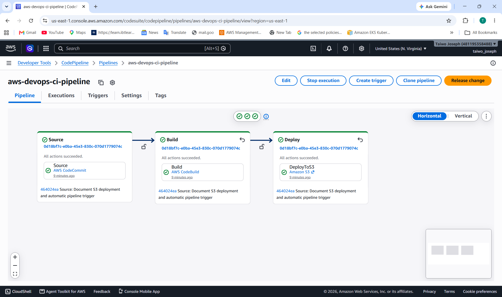
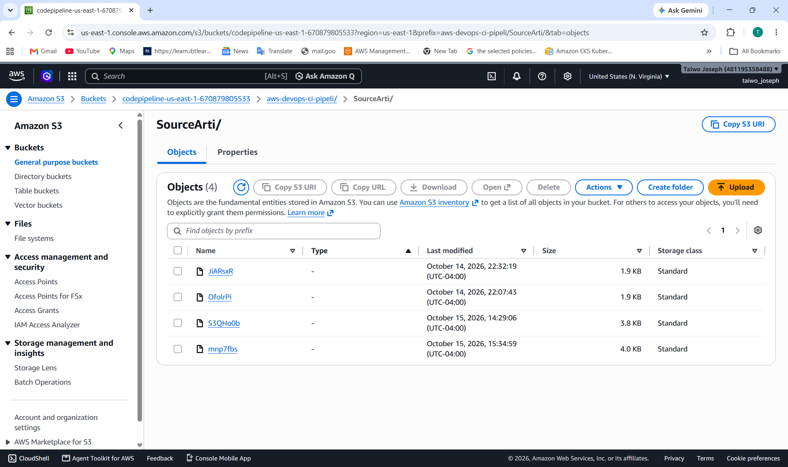
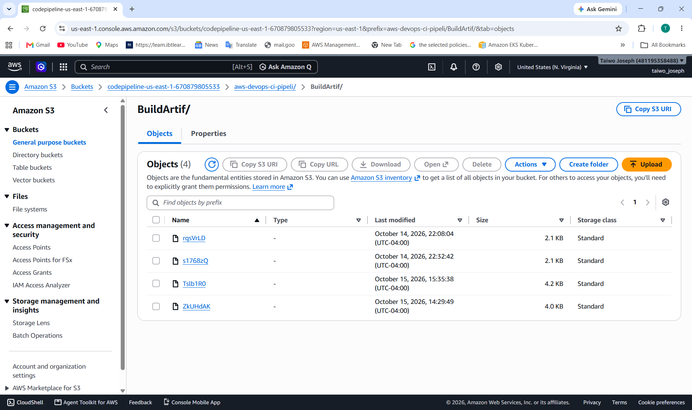
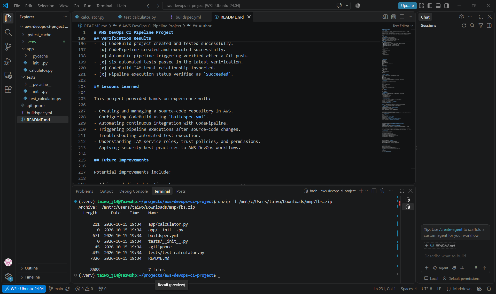
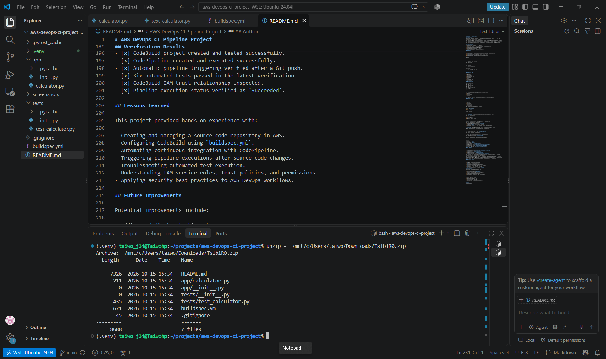
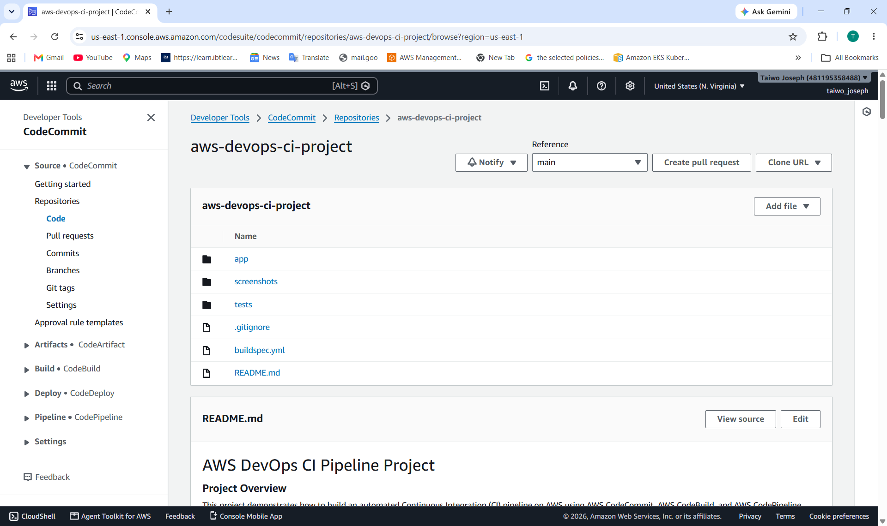
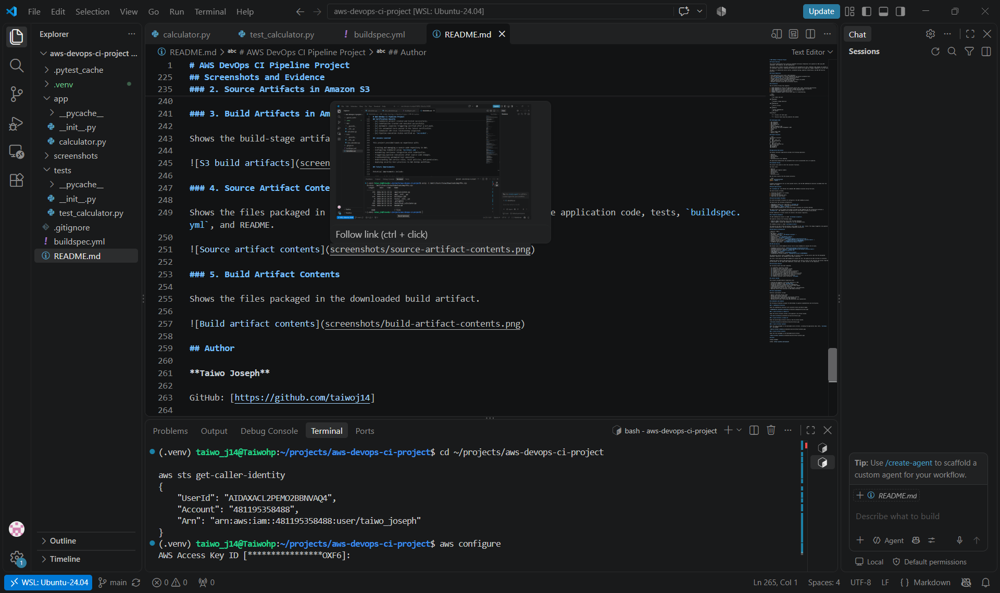

# AWS DevOps CI Pipeline Project

## Project Overview

This project demonstrates how to build an automated Continuous Integration (CI) pipeline on AWS using AWS CodeCommit, AWS CodeBuild, and AWS CodePipeline.

The project uses a Python calculator application with automated unit tests. Whenever code changes are pushed to the CodeCommit repository, CodePipeline automatically detects the change and triggers CodeBuild to run the tests.

The goal is to demonstrate source control, automated testing, pipeline orchestration, and AWS IAM security practices.

## Project Objectives

- Store application source code in AWS CodeCommit.
- Configure AWS CodeBuild to install dependencies and execute automated tests.
- Use a `buildspec.yml` file to define the build process.
- Automate the CI workflow using AWS CodePipeline.
- Trigger pipeline executions automatically when changes are pushed.
- Apply IAM permissions to support the pipeline.
- Document successful builds and verification results.

## Architecture

The CI workflow follows this sequence:

1. **AWS CodeCommit:** Stores the application source code, tests, and build specification.
2. **AWS CodePipeline:** Detects repository changes and coordinates the pipeline.
3. **AWS CodeBuild:** Installs pytest and runs the automated tests.
4. **Amazon S3:** Stores pipeline artifacts.
5. **Amazon CloudWatch Logs:** Stores build logs for troubleshooting.

```text
Developer
    |
    | Git commit and push
    v
AWS CodeCommit
    |
    | Automatic change detection
    v
AWS CodePipeline
    |
    | Source artifact
    v
AWS CodeBuild
    |
    | Install dependencies
    | Run pytest
    v
Build Result
    |
    +---- Success: All tests pass
    |
    +---- Failure: Build logs help identify the problem
```

## Technologies Used

- AWS CodeCommit
- AWS CodeBuild
- AWS CodePipeline
- Amazon S3
- Amazon CloudWatch Logs
- AWS Identity and Access Management (IAM)
- Python 3.12
- pytest
- Git
- Visual Studio Code
- Ubuntu on WSL2

## Project Structure

```text
aws-devops-ci-project/
├── app/
│   ├── __init__.py
│   └── calculator.py
├── tests/
│   ├── __init__.py
│   └── test_calculator.py
├── buildspec.yml
├── .gitignore
└── README.md
```

## Application Description

The Python calculator application provides the following operations:

- Addition
- Subtraction
- Multiplication
- Division
- Division-by-zero error handling

The application demonstrates how automated tests can be incorporated into a CI pipeline.

## Automated Testing

The project uses pytest to test the calculator functions.

The tests cover:

- Addition
- Addition with negative numbers
- Subtraction
- Multiplication
- Division
- Division by zero

Run the tests locally from the project directory:

```bash
source .venv/bin/activate
python -m pytest -v
```

**Latest verification:** All six tests passed locally, and the AWS CodePipeline execution succeeded after the latest test change.

## Build Specification

The `buildspec.yml` file defines the commands AWS CodeBuild executes during the build.

The build process includes:

1. Selecting the Python 3.12 runtime.
2. Installing pytest.
3. Executing the automated tests.
4. Reporting the build result.

## Build Environment Variables

No custom environment variables are configured in the AWS CodeBuild project.

The build uses the following configuration:

- **Runtime:** Python 3.12, specified in `buildspec.yml`.
- **Dependency:** `pytest`, installed during the build.
- **Test command:** `python -m pytest -v`.
- **Environment variables:** No custom environment variables are currently defined.

The build relies on the standard environment provided by AWS CodeBuild and the configuration defined in `buildspec.yml`. AWS CodeBuild also provides built-in environment variables during builds.

No AWS credentials or secret values are stored in the project repository.

## CI Pipeline Automation

The AWS CodePipeline project is named `aws-devops-ci-pipeline`.

The pipeline contains the following three stages:

- **Source stage:** Retrieves source code from the AWS CodeCommit repository `aws-devops-ci-project`, branch `main`.
- **Build stage:** Invokes AWS CodeBuild to install pytest and run the automated tests.
- **Deploy stage:** Deploys the build artifact to the `production/` prefix in the Amazon S3 deployment bucket `taiwo-aws-devops-ci-deploy-2026`.

The CodeBuild project is named `aws-devops-ci-build`.

### Automatic Change Detection

Amazon EventBridge monitors changes to the CodeCommit repository and the `main` branch. When a new commit is pushed, the EventBridge rule starts the CodePipeline automatically.

- **EventBridge rule:** `codepipeline-awsdev-main-114714-rule`
- **Rule status:** Enabled
- **Event source:** AWS CodeCommit
- **Target pipeline:** `aws-devops-ci-pipeline`

### Automatic Trigger Verification

Automatic pipeline triggering was tested by committing and pushing the CodeCommit repository screenshot to the `main` branch.

- **Test commit:** `1da4a9236e6c5bb697495badc1e6d42d3c03912f`
- **Pipeline execution ID:** `98f33d84-269d-4d4f-a24e-60435b09882e`
- **Execution result:** Succeeded

The pipeline execution used the same commit that was pushed to CodeCommit. This verified that the configured EventBridge rule triggered the pipeline automatically without a manual pipeline release.

## AWS Resource Configuration

| Resource | Name |
|---|---|
| AWS Region | `us-east-1` |
| CodeCommit repository | `aws-devops-ci-project` |
| Source branch | `main` |
| CodeBuild project | `aws-devops-ci-build` |
| CodePipeline | `aws-devops-ci-pipeline` |
| CodeBuild service role | `codebuild-aws-devops-ci-build-service-role` |
| CodeBuild permissions policy | `CodeBuildBasePolicy-aws-devops-ci-build-us-east-1` |
| Pipeline artifact bucket | `codepipeline-us-east-1-670879805533` |
| CloudWatch Logs group | `/aws/codebuild/aws-devops-ci-build` |

## IAM and Security

The project uses an AWS CodeBuild service role to allow CodeBuild to execute the CI build.

- **CodeBuild service role:** `codebuild-aws-devops-ci-build-service-role`
- **Attached permissions policy:** `CodeBuildBasePolicy-aws-devops-ci-build-us-east-1`
- **Trusted service:** `codebuild.amazonaws.com`
- **AWS Region:** `us-east-1`
- **CodeCommit repository:** `aws-devops-ci-project`
- **CodePipeline artifact bucket:** `codepipeline-us-east-1-670879805533`

The permissions policy covers CloudWatch Logs, S3 artifact access, pulling source code from the designated CodeCommit repository, and CodeBuild test-report operations.

The role's trust policy allows AWS CodeBuild to assume the role. The pipeline has been verified as successful.

**Security note:** Review IAM permissions periodically and restrict access to the resources and actions required by the project. Do not commit AWS credentials, access keys, or other secrets to the repository.

## Verification Results

The following checks have been completed:

- [x] CodeCommit repository created.
- [x] Python calculator application created.
- [x] Automated unit tests passed locally.
- [x] CodeBuild project created and tested successfully.
- [x] CodePipeline created and executed successfully.
- [x] Automatic pipeline triggering verified after a Git push.
- [x] Six automated tests passed in the latest verification.
- [x] CodeBuild IAM trust relationship inspected.
- [x] Pipeline execution status verified as `Succeeded`.

## Lessons Learned

This project provided hands-on experience with:

- Creating and managing a source-code repository in AWS.
- Configuring CodeBuild using `buildspec.yml`.
- Automating continuous integration with CodePipeline.
- Triggering pipeline executions after source-code changes.
- Troubleshooting automated test execution.
- Understanding IAM service roles, trust policies, and permissions.
- Applying security best practices to AWS DevOps workflows.

## Future Improvements

Potential improvements include:

- Adding a dedicated testing stage.
- Adding code coverage reporting.
- Introducing static code analysis and security scanning.
- Adding deployment automation with AWS CodeDeploy.
- Reviewing and further restricting IAM permissions where appropriate.

## Screenshots and Evidence

The following screenshots document the AWS DevOps CI pipeline implementation and verification.

### 1. CodePipeline Execution

Shows the CodePipeline execution with successful Source and Build stages.



### 2. Source Artifacts in Amazon S3

Shows the source artifacts stored in the pipeline's S3 artifact bucket.



### 3. Build Artifacts in Amazon S3

Shows the build-stage artifacts stored in the S3 artifact bucket.



### 4. Source Artifact Contents

Shows the files packaged in the downloaded source artifact, including the application code, tests, `buildspec.yml`, and README.



### 5. Build Artifact Contents

Shows the files packaged in the downloaded build artifact.



### 6. CodeCommit Repository

Shows the AWS CodeCommit repository used as the source for the CI pipeline.



## AWS CLI Verification

The AWS CLI was verified using the `aws sts get-caller-identity` command.
The command successfully returned the configured IAM identity.



## Author

**Taiwo Joseph**

GitHub: [https://github.com/taiwoj14]

